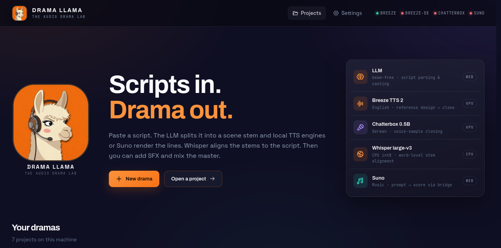
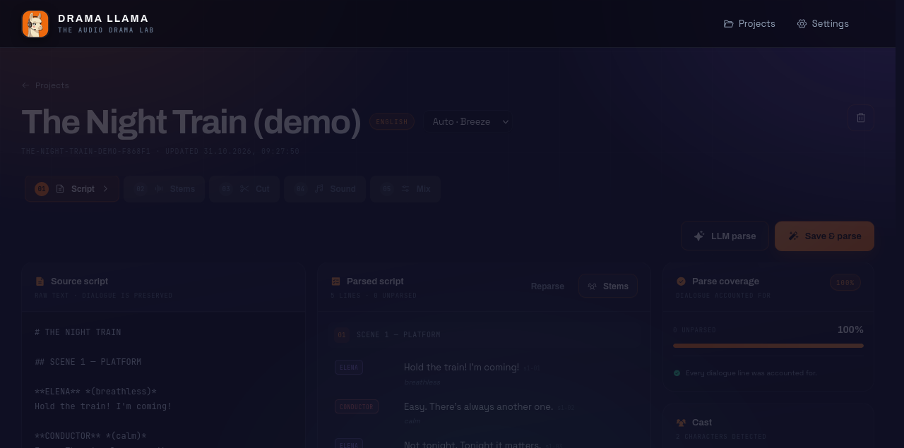
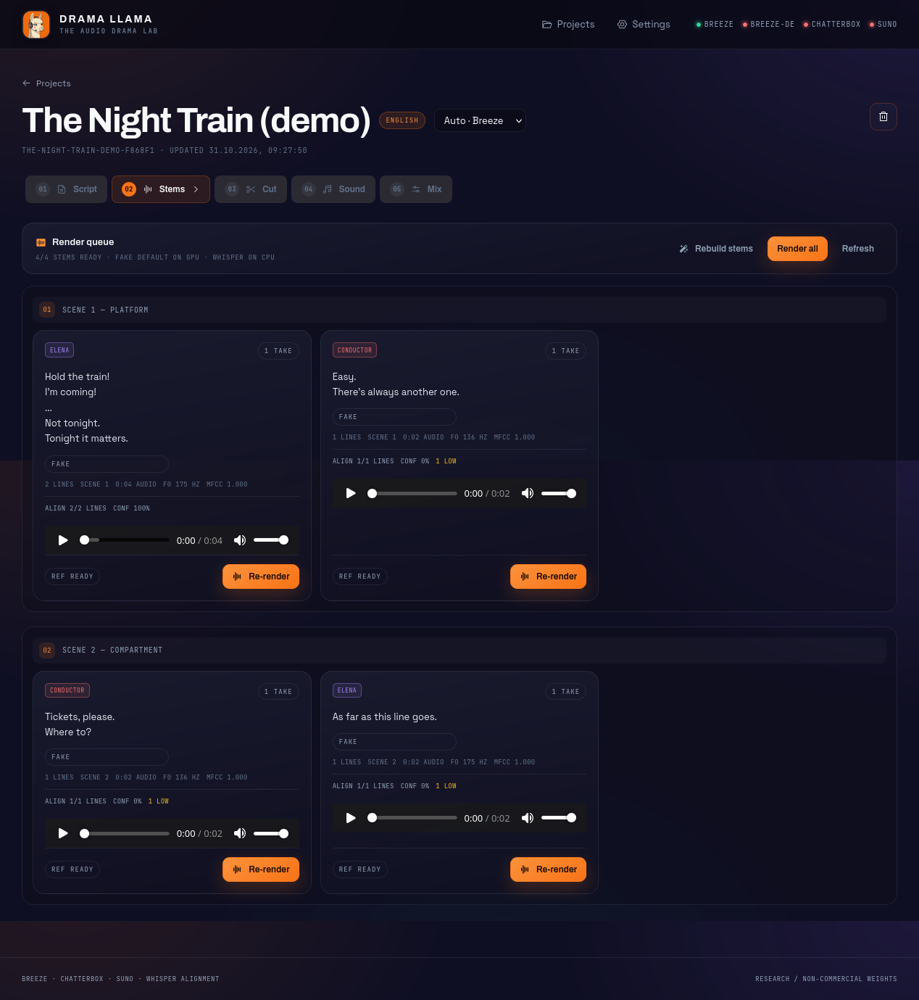
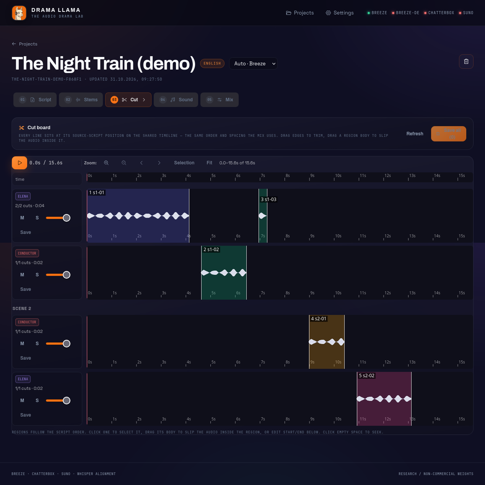
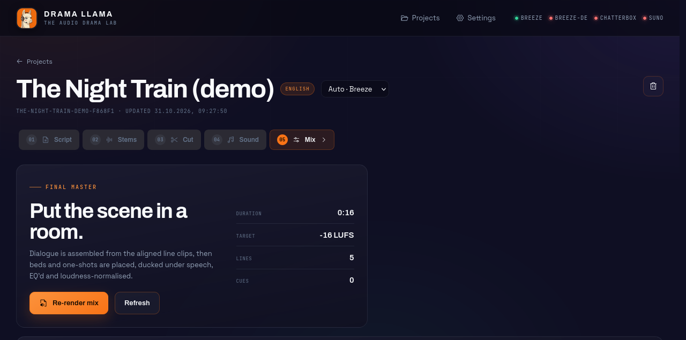

# Drama Llama


A local-first web app that turns a pasted script into a finished audio drama.

Paste a script and Drama Llama parses it into scenes and dialogue lines
(deterministically, or normalized by a local LLM for messy formatting), then
groups the lines by scene and speaker into stem scripts. Each stem is rendered
with the project's default engine — Breeze or the Breeze-DE sidecar for
designed-clone voices, Chatterbox for sample-cloned voices, Suno for sung
dialogue, or the Fake engine for tests — producing one or more takes per
character. Whisper aligns every take on CPU and cuts per-line clips, which you
refine on the shared Cut board: trim windows, slip audio inside regions, pick
each clip's take. SFX beds, one-shots and music cues are anchored to lines —
music generated live with Suno through the BetterSuno browser extension —
then everything is assembled, ducked, EQ'd and loudness-normalised into the
WAV/MP3 master.

## Tour

| | |
|---|---|
|  | **Projects** — every drama on this machine, with the engine stack (LLM → voices → alignment → music) up top. |
|  | **Script** — paste a script, parse deterministically or via LLM, inspect the cast. |
|  | **Stems & Render** — per-scene, per-character stems rendered with the project-default engine; takes accumulate for A/B comparison. |
|  | **Cut** — the shared multitrack timeline: every line at its script position, per-clip take choice, drag to trim, Save-all rebuilds the mix once. |
|  | **Mix** — dialogue assembly with ducked SFX, loudness-normalised master, WAV/MP3 download. |

Screenshots taken live against the running app (`fake` engine demo project,
no GPU needed).

▶️ [Watch the guide video](docs/drama-llama-guide.mp4) (96 s) — the full tour
above, screen-recorded in the app with real Breeze voices: script, render
queue, Cut board, sound, mix, with the rendered master as soundtrack.

## Status

Working end-to-end on the English path:

- Paste Markdown / screenplay / plain text, deterministic parse with cast-table
  detection, speaker aliases, stage directions and 100% dialogue coverage.
- Optional LLM parse: the model reformats any script style (`[NAME] "text"`,
  `Name: "text"`, `NAME (direction) text`, …) into the canonical
  `NAME (direction): text` format, which the deterministic parser then reads;
  strict verbatim validation with a deterministic fallback.
- Per-scene, per-character stem scripts.
- Breeze reference design → scene-stem render → Whisper CPU alignment → line
  clips. Validated on one real scene: 10.1 s load, 103.5 s render for 28.0 s
  audio, 60.8 s alignment, 6/6 lines at confidence 1.0, 8.47 GB peak VRAM.
- SFX library indexing over `~/Sounds` + uploads, cue sheet anchored to lines.
- Mix: dialogue assembly, bed ducking, telephone filter, −16/−23 LUFS
  loudnorm, WAV + MP3. Demo mix: 27 lines, 94.3 s, 1 cue, no warnings.
- German path uses **Chatterbox Multilingual 0.5B** over its local HTTP server
  (per-character voice samples, exaggeration/cfg per take). Verified end-to-end:
  a 20.7 s ANNA stem, 7/7 line cuts, and a 46.8 s test mix.
- **Suno music** through the `bettersuno-mcp` modules: generate a theme/bed/song
  in the Sound stage, preview the returned track, add it as a music cue, then
  mix. Validated with a real BetterSuno extension connection and WAV download.
- **Project-level engines, take-aware cuts**: one engine per project (Breeze,
  Breeze-DE, Chatterbox, Suno or Fake — no per-stem switching); every cut names
  the take it was measured on. Suno re-renders append generations instead of
  replacing them, manual trims survive, and the Cut board edits all stems on
  one shared timeline with per-clip take choice, atomic batch saves and a
  single mix rebuild. A queued realign never clobbers newer manual trims.

## Installation

A clean setup needs three prerequisites: Python 3.12 or newer, an `ffmpeg`
binary on `PATH` (the mixer shells out to it for loudness normalisation and
MP3 encoding, and uploads are converted with it), and Node.js 20 or newer
for the web frontend. A local NVIDIA GPU is optional but recommended —
without one, Breeze renders and Whisper alignment fall back to slow CPU
execution, while the Fake engine and the full test suite run anywhere.

Clone the repository and pull in the BetterSuno submodule, which the music
sidecar depends on:

```bash
git clone git@github.com:MrDoe/DramaLlama.git
cd DramaLlama
git submodule update --init
```

Create a fresh virtual environment and install the package into it. The base
install only declares the light web dependencies (FastAPI, uvicorn, pydantic),
so it works immediately for the UI, the queue and the test suite:

```bash
python3.12 -m venv ~/.venvs/drama-llama
~/.venvs/drama-llama/bin/pip install -U pip
~/.venvs/drama-llama/bin/pip install -e . --no-deps
~/.venvs/drama-llama/bin/pip install -e ".[dev]"   # tests + lint
```

Rendering and alignment need the audio stack on top. Install it into the same
environment: `pip install numpy soundfile faster-whisper demucs`, plus a
matching `torch` build — the CUDA build from pytorch.org for GPU machines,
the default CPU build otherwise. Demucs is invoked as `python -m demucs`,
so it must resolve inside the venv; everything else is imported directly,
and the app degrades gracefully when a model is missing (render jobs fail
with a plain-language error instead of crashing the worker).

Build the frontend once with npm; afterwards `./start-ui.sh` rebuilds only
when sources are newer than `web/dist`:

```bash
cd web && npm install && npm run build && cd ..
```

Then start the app. `serve` runs the FastAPI backend together with an
in-process worker on `http://127.0.0.1:8770`:

```bash
~/.venvs/drama-llama/bin/drama-llama serve
```

The legacy `drama-studio` command is installed as an alias. If you prefer to
debug model loads separately, pass `--no-worker` and run
`~/.venvs/drama-llama/bin/drama-llama worker --once` in a second terminal;
`~/.venvs/drama-llama/bin/drama-llama jobs` inspects the queue. The
`./start-ui.sh` launcher wraps all of this: it builds when stale and serves,
with `--dev` for Vite hot reload on :5173, `--open` to launch the browser
once `/api/health` passes, and `--build` / `--no-build` to control the
rebuild.

### Suno music bridge

Suno needs the BetterSuno browser extension and a `suno.com` tab. The
submodule was already fetched during installation; make sure its own
dependencies are installed once (its postinstall script is local-only, so a
plain install skips it upstream — use `ci --ignore-scripts` inside
`third_party/bettersuno-mcp`), then start the HTTP sidecar in another
terminal with `~/.venvs/drama-llama/bin/drama-llama suno-bridge` (`serve`
starts it automatically unless `--no-suno-bridge` is given).

The bridge listens on `http://127.0.0.1:9430` and owns the extension WebSocket
on `ws://127.0.0.1:9423`. Only one process can own 9423 at a time; stop any
other `bettersuno-mcp` instance first. The Sound stage shows connection status
and the Suno generation form. Downloads use the WAV conversion flow so the
mixer always receives a decodable file.

## Workflow

1. **Script** — paste a script, choose English or German.
   `Save & parse` is deterministic; `LLM parse` first has the model normalize
   messy attribution into the canonical format and falls back safely if the
   model is offline.
2. **Stems & Render** — group lines by scene + speaker, then render with the
   project's default engine (picker in the project header; `auto` means Breeze
   for English, Chatterbox for German). Breeze uses a 6–11 s designed
   reference; Chatterbox uses an uploaded voice sample or its default voice.
   The worker renders, aligns with Whisper on CPU, cuts line clips, and stores
   confidence. Takes accumulate and stay labelled by engine for A/B
   comparison; switching a cut's take scales its window by the duration ratio.
3. **Cut** — trim every line on one shared timeline (script order, mixer
   spacing). Drag edges to trim, drag a region body to slip the audio inside
   it, switch a clip's take from the Track dropdown, then Save-all: all stems
   validate atomically and the mix rebuilds once. A `mix stale` badge appears
   whenever cuts change after the last mix.
4. **Sound** — search `~/Sounds` (plus `data/sfx` and uploads), preview, and
   attach beds / one-shots / music to specific lines. Or generate music with
   Suno and add the returned track as a cue.
5. **Mix** — assemble line clips, duck beds under speech, filter telephone
   lines, loudnorm to podcast (−16 LUFS) or broadcast (−23 LUFS), and download
   WAV/MP3.

## Engines

| Language | Engine | Voice workflow |
|---|---|---|
| English | Breeze TTS 2 | 6–11 s reference design → clone per scene stem |
| German | Breeze-TTS-2.cpp (Articulatio-DE) | optional sidecar: voice design or clone; research/non-commercial |
| English/German | Chatterbox Multilingual 0.5B | uploaded voice sample → clone; default voice if none |
| both | Fake | sine/noise stems, no GPU |
| music | Suno via BetterSuno | prompt → generated track → music cue |

Chatterbox expects its model server at `http://127.0.0.1:4123`; it can be
started independently and keeps the model warm. Drama Llama only sends text
and an optional voice sample over HTTP.

### German Breeze sidecar (optional)

A community German finetune (Articulatio-DE) runs on the `Breeze-TTS-2.cpp`
engine. Download the prebuilt binary and the Q8_0 GGUF, then start the sidecar:

```bash
~/.venvs/qwen3tts/bin/drama-llama breeze-de
# http://127.0.0.1:8137  (override with --port / BREEZE_DE_URL)
```

The sidecar owns the GPU; Drama Llama serializes GPU jobs, so stop it (or
the LLM) before loading another model. Weights/outputs are research /
non-commercial.

Breeze weights and outputs are research / non-commercial only. The vendored
stem/aligner is Apache 2.0 code; see `vendor/breeze_stems/VENDORED_FROM.md`.

## Layout

| Path | Purpose |
|---|---|
| `src/drama_studio/` | FastAPI, queue, worker, parser, engines, mixer |
| `src/drama_studio/engines/` | Breeze / Breeze-DE / Chatterbox / Suno / Fake adapters |
| `src/drama_studio/cuts.py` | shared take-aware cut logic (freeze/remap/validate) |
| `vendor/breeze_stems/` | pinned Breeze stem renderer + Whisper aligner |
| `suno-bridge/` | Node HTTP sidecar over the installed bettersuno-mcp modules |
| `web/` | React + Vite + TypeScript UI |
| `web/public/` | Drama Llama mascot (`llogo.png`) |
| `docs/screenshots/` | app tour screenshots (taken live, fake-engine demo) |
| `data/projects/<id>/` | project JSON, refs, takes, line clips, mix |
| `data/jobs.sqlite3` | job queue (SQLite, WAL) |
| `tests/` | 186 tests, no GPU required |

The Python package keeps its `drama_studio` import name; only the product,
CLI and UI were renamed.

## Configuration

Environment variables:

| Variable | Default |
|---|---|
| `DRAMA_LLAMA_DATA` | `<repo>/data` |
| `DRAMA_LLAMA_HOST` / `PORT` | `127.0.0.1` / `8770` |
| `DRAMA_LLAMA_LLM` | `gemma4:12b-16k` |
| `DRAMA_LLAMA_LLM_API` | `ollama` — or `openai` for OpenAI-compatible endpoints |
| `DRAMA_LLAMA_LLM_URL` | `http://127.0.0.1:11434` (falls back to `OLLAMA_URL`) |
| `DRAMA_LLAMA_LLM_API_KEY` | _(empty)_ — bearer token for hosted/cloud endpoints |
| `CHATTERBOX_URL` | `http://127.0.0.1:4123` |
| `BREEZE_DE_URL` | `http://127.0.0.1:8080` |
| `SUNO_BRIDGE_URL` | `http://127.0.0.1:9430` |
| `DRAMA_LLAMA_SFX_ROOTS` | `~/Sounds:<repo>/data/sfx` |

The old `DRAMA_STUDIO_*` names still work as fallbacks.

The script-parsing LLM is local Ollama by default. Configure it in the
**Settings** page (topbar): protocol (Ollama / OpenAI-compatible), endpoint
URL, model (with a picker fed by the endpoint's own model list), and an
optional API key for hosted endpoints — with a Test connection button before
you save. Choices persist to `data/settings.json` (gitignored; the key itself
is never returned by the API) and apply immediately, including to the
front-page engine stack. Per key, the settings file beats
`DRAMA_LLAMA_LLM_URL` / `DRAMA_LLAMA_LLM` / `DRAMA_LLAMA_LLM_API_KEY`
environment variables; unset keys still follow the environment
(`GET /api/config` reports each value's source).

### OpenCode Go as the LLM (optional)

With an [OpenCode Go](https://opencode.ai/v2/docs/console/go/) subscription,
Drama Llama can parse scripts with a hosted model instead of the local GPU one
— handy on low-VRAM machines, since the local LLM holds ~7.6 GB:

```bash
export DRAMA_LLAMA_LLM_API=openai
export DRAMA_LLAMA_LLM_URL=https://opencode.ai/inference/go/openai/v1
export DRAMA_LLAMA_LLM_API_KEY=<your Go API key from the OpenCode Console>
export DRAMA_LLAMA_LLM=kimi-k3   # or glm-5.3-flash, muse-spark-1.3-contributor, …
```

Every Go text model works through that OpenAI-compatible endpoint (the Console
translates between API families). The client identifies as `drama-llama/<ver>`
and sends a per-parse `x-opencode-session` header, as Go requires of non-OpenCode
clients. Two caveats: Go traffic counts against your subscription limits
(script parses are long — a full drama can be several thousand tokens), and
some Go models train on request data (e.g. the Muse Spark contributors — see
the [Go privacy table](https://opencode.ai/v2/docs/console/go/#privacy)).

The Settings page tests the endpoint before you save: it lists usable models
(embedding-only models are hidden and counted) and reports precise failures —
HTTP 401 means the API key is wrong, 403 that the plan or model doesn't cover
API use, and anything else a reachability problem.

Personal subfolders (`juli`, `miller`, `Projects`, `Snippets`) are excluded
from the SFX index by default.

## Testing

```bash
~/.venvs/qwen3tts/bin/python -m pytest
cd web && npm run build
```

Real-model smoke tests are opt-in:

```bash
~/.venvs/qwen3tts/bin/python scripts/smoke_breeze.py --scene 1 --speaker MARA
```

## Known gaps

- Chatterbox voice samples are uploaded per character, but there is no in-app
  recorder or trimmer yet; without a sample it uses the server default voice.
- Suno generation needs the BetterSuno extension and a live `suno.com` tab.
  The bridge owns port 9423, so other `bettersuno-mcp` instances must be stopped.
- Cue timing is line-anchored; SFX cannot yet be dragged on the Cut timeline.
- LLM parse requires Ollama and is intentionally serialized against Breeze on
  the 16 GB GPU.
